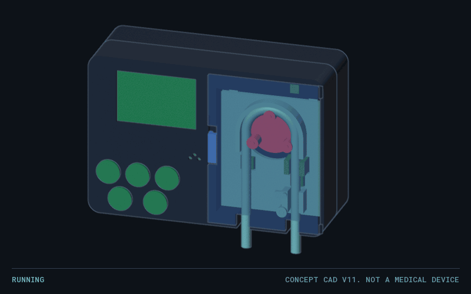

# open-feed-pump

An open source, portable enteral feeding pump: a rotary peristaltic pump in the same class as the Moog Infinity, with an open, non-proprietary tubing cassette. The mechanical design is written with [nl-cad](https://github.com/owenpkent/nl-cad) (natural-language CAD on build123d).

> **Not a medical device. Never connect this to a person.** Nothing here has been tested, cleared or approved. A feeding pump that fails can injure or kill: over-delivery can cause aspiration, and silent under-delivery can cause dehydration or dangerous low blood sugar. Bench test with water into a measuring container only.

## Status

Concept CAD, build v11. No hardware built, no firmware written.



Open the model yourself in [the viewer](projects/feed-pump/builds/v11/feed-pump_viewer_v11.html) (one offline HTML file, not tracked; to regenerate it, see `projects/feed-pump/tools/viewer.embed.config.ts`).

## Goals

- Match the functions that matter on a pump like the Infinity: 0.1 to 600 mL/hr, 24 hours on battery, usable in any orientation, and alarms for occlusion, air and an open door.
- **Open consumable:** a cassette anyone can make from stock silicone tube, because dedicated sets are the recurring cost and the supply risk of a commercial pump.
- **Safety first:** free flow is blocked mechanically, and a second processor can cut the motor. See [docs/Hazards v1.md](docs/Hazards%20v1.md).
- **Accessible:** low-force door and cassette loading, large buttons, a socket for an assistive switch, and an AMPS mount for wheelchairs and pole clamps.

This is an original design. It takes target numbers from the published manual, and it does not copy the Infinity's appearance, cassette or code.

## Layout

| Path | Holds |
|---|---|
| [docs/Requirements v1.md](docs/Requirements%20v1.md) | What the pump must do, with a source for every number |
| [docs/Hazards v1.md](docs/Hazards%20v1.md) | What can hurt someone, and the design control for each |
| [projects/feed-pump/](projects/feed-pump/) | The CAD project: brief, assembly, one file per part, numbered builds |
| [build.cmd](build.cmd) | Build the next version of the CAD |

## Build the CAD

Needs a local checkout of nl-cad next to this repo at `..\nl-cad`, with `uv sync` already run there. nl-cad is private for now (it contains code awaiting a licence), so outside contributors cannot rebuild yet, and the link above will not open for them. They can use the STEP file in each folder under `projects/feed-pump/builds/`.

```
build.cmd "what changed in this build"
```

## License

Everything here, including part files and scripts: [CERN-OHL-P-2.0](LICENSE). Firmware, when it exists, will be MIT.
